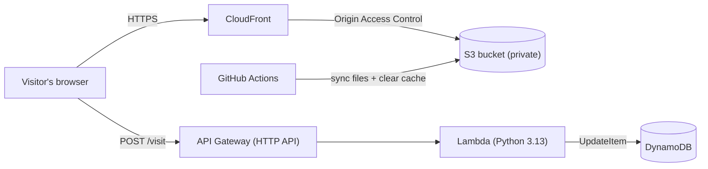

# Cloud Portfolio

My personal portfolio website, hosted on AWS and built the way a real cloud team would: infrastructure as code, automated deployments, a serverless backend, and automated tests.

**Live site:** https://d2qbad4gliub2j.cloudfront.net

**Stack:** AWS (S3, CloudFront, Lambda, API Gateway, DynamoDB, IAM, CloudWatch) · Terraform · GitHub Actions · Python · pytest

---

## Architecture



**How a visit works**

1. The browser loads the page from **CloudFront**, which fetches files from a **private S3 bucket**. Visitors can never reach the bucket directly; only CloudFront has access, through Origin Access Control (OAC).
2. JavaScript on the page calls the **API Gateway** endpoint.
3. API Gateway runs a **Lambda** function (Python), which atomically adds 1 to the visitor count in **DynamoDB** and returns the new number.
4. The page displays the count in the footer.

---

## Features

- **Infrastructure as Code:** every AWS resource is defined in Terraform. State is stored remotely in S3 with versioning, encryption and native state locking.
- **CI/CD:** pushing changes to `site/` triggers GitHub Actions, which syncs the files to S3 and invalidates the CloudFront cache automatically.
- **Serverless backend:** API Gateway → Lambda → DynamoDB, with no servers running while nobody visits.
- **Automated tests:** pytest tests run against a mocked DynamoDB (moto) on every backend change, both locally and in GitHub Actions.

---

## Security and design decisions

| Decision | Why |
|---|---|
| Private S3 bucket + CloudFront OAC | Visitors can only reach content through CloudFront; the bucket blocks all public access. |
| Bucket policy limited to one distribution | Only *my* CloudFront distribution can read the bucket (`AWS:SourceArn` condition). |
| Least-privilege IAM everywhere | The Lambda role can only `UpdateItem` on one table. The deploy user can only write to one bucket and invalidate one distribution. |
| IAM user for GitHub Actions instead of OIDC | OIDC is the preferred approach, but my AWS account type has an AWS-managed Service Control Policy that blocks creating OIDC identity providers. I used a least-privilege IAM user with keys stored in GitHub Secrets as a workaround. |
| Short-lived credentials locally | `aws login` gives my laptop temporary, auto-rotating credentials, so no long-term access keys are stored on my machine. |
| CORS + API throttling | CORS only allows my site to call the API from a browser; throttling (10 req/s, burst 20) protects against abuse and unexpected costs. |
| Remote Terraform state with locking | State survives if my laptop doesn't, and two runs can't modify infrastructure at the same time. |
| DynamoDB provisioned at 1 RCU / 1 WCU | Enough for a portfolio and stays within DynamoDB's always-free allowance. |
| 14-day log retention | Lambda logs don't pile up forever. |
| Budget alert | Email warning if monthly spend passes $5. |

---

## Repository structure

```
cloud-portfolio/
├── site/                     # Static website (HTML)
├── backend/
│   └── counter/
│       ├── app.py            # Lambda function (visitor counter)
│       ├── requirements-dev.txt
│       └── test/
│           └── test_app.py   # pytest tests with mocked DynamoDB
├── terraform/                # All AWS infrastructure
│   ├── providers.tf          # Providers + remote state backend
│   ├── variables.tf
│   ├── main.tf               # S3, CloudFront, OAC, bucket policy
│   ├── counter.tf            # DynamoDB, Lambda, API Gateway, IAM
│   ├── github-deploy-user.tf # Least-privilege deploy user
│   └── output.tf
└── .github/workflows/
    ├── deploy-site.yml       # Deploy site on push
    └── test-backend.yml      # Run backend tests on push
```

---

## Running it yourself

**Prerequisites:** AWS CLI (2.32+), Terraform (1.15+), Python 3.13, Git.

```bash
# 1. Log in to AWS (temporary credentials)
aws login --profile portfolio

# 2. Build the infrastructure
cd terraform
terraform init
terraform apply

# 3. Upload the site
aws s3 sync ../site "s3://$(terraform output -raw bucket_name)" --profile portfolio

# 4. Run the backend tests
cd ..
python -m venv .venv
source .venv/bin/activate        # Windows: .venv\Scripts\Activate.ps1
pip install -r backend/counter/requirements-dev.txt
python -m pytest backend/counter/test -v
```

After the first setup, website changes deploy automatically on `git push`.

---

## What I'd improve next

- Custom domain with Route 53 and an HTTPS certificate
- Switch GitHub Actions to OIDC if the account type allows it
- Deploy the Lambda code through the pipeline instead of Terraform
- Run `terraform plan` automatically on pull requests
- CloudWatch alarms for Lambda errors

---

## Build journal

I kept a log of every session: what I did, what confused me, and what I learned.

### Session 1: Account setup
- **Did:** Created an AWS account, turned on MFA with an authenticator app, set a $5 monthly budget alert.
- **Confused by:** My account uses AWS's new "projects" experience, so there was no root user or Security credentials menu. Found MFA under AWS Settings → Manage security and sign-in.
- **Learned:** MFA protects against stolen passwords. Budgets warn you; spend limits stop spending.

### Session 2: First homepage + Git setup
- **Did:** Installed Git and VS Code, cloned the repo, created `site/index.html`, and pushed it to GitHub.
- **Confused by:** "git is not recognized" (the terminal needed restarting after installing Git); a typo in `user.name`; cloning with a file link instead of the repo link.
- **Learned:** Repo links end in `.git`. Workflow: clone once, then add → commit → push.

### Session 3: Hosting with S3 and CloudFront (by hand)
- **Did:** Created a private S3 bucket, uploaded the site, and set up a CloudFront distribution with Origin Access Control in the console.
- **Confused by:** Which origin type to choose, whether to enable WAF, and why site updates didn't appear (CloudFront caching).
- **Learned:** The origin is where CloudFront fetches content from. Security should match the risk: a static site didn't need a paid WAF yet. Updating a site means uploading to S3 *and* invalidating the CloudFront cache.

### Session 4: Infrastructure as Code
- **Did:** Rebuilt the site with Terraform (S3 + OAC + CloudFront + bucket policy), uploaded with `aws s3 sync`, then deleted the hand-made version.
- **Confused by:** Network timeouts downloading the provider; "undeclared resource" and "requires explicit configuration" errors (both caused by unsaved files).
- **Learned:** Terraform describes the end result and works out the order from references. State is Terraform's memory; never edit Terraform-managed resources by hand (drift).

### Session 5: Remote state and the deploy pipeline
- **Did:** Moved Terraform state to an S3 bucket with versioning and locking. Built a GitHub Actions workflow that deploys the site on every push.
- **Confused by:** Creating an OIDC provider failed with "explicit deny in a service control policy." Later, the pipeline failed twice: an invalid access key, then a variable containing a Terraform expression instead of the real bucket name.
- **Learned:** An SCP is an organization-level guardrail that overrides even admin permissions. Removing it would require upgrading and activating advanced features (irreversible), so I used a least-privilege IAM user instead. Debugging pipelines means opening the failed step and reading the first error line.

### Session 6: Visitor counter
- **Did:** Built a serverless backend (API Gateway → Lambda in Python → DynamoDB) with Terraform and connected it to the site with JavaScript.
- **Confused by:** The counter showed "unavailable." Browser DevTools showed `ERR_NAME_NOT_RESOLVED`: the page was still calling a placeholder API URL.
- **Learned:** CORS limits which websites can call an API from a browser; throttling protects against everything else. DevTools Console is the first place to look when a page misbehaves.

### Session 7: Automated tests
- **Did:** Wrote pytest tests for the Lambda function using moto to fake DynamoDB, and added a GitHub Actions workflow that runs them on every backend change.
- **Confused by:** pytest found 0 tests at first (a file naming issue: pytest only collects `test_*.py` files and `test_*` functions). Also why GitHub stayed green after I broke the code on purpose: I hadn't pushed the broken version.
- **Learned:** Local tests give fast feedback while working; pipeline tests run on a clean machine after every push and protect the whole team. Tests only catch what they check.